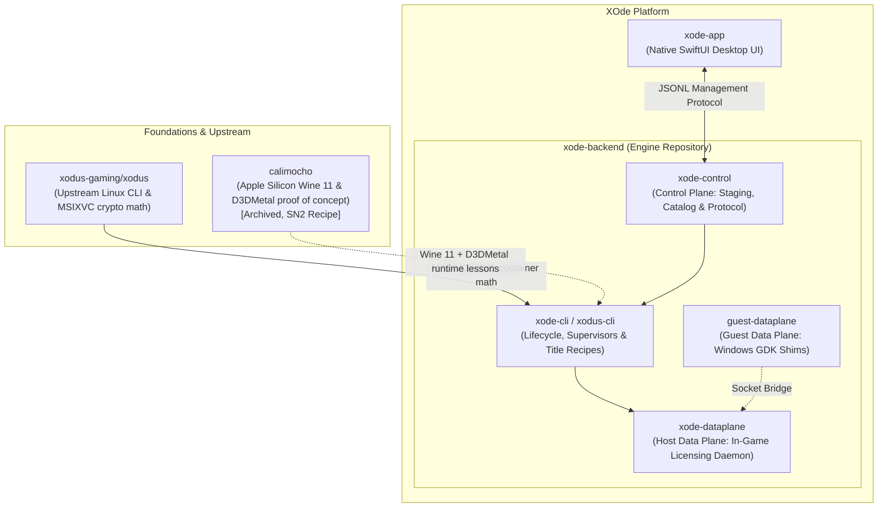

# calimocho

> **Archived 2026-06-01.** This repo is a recipe. Use Porting Kit
> instead. See below.
>
> Subnautica 2 plays on Apple Silicon, for free, on a fully FOSS +
> Apple D3DMetal stack. Calimocho did not build it. Other people did.
> This README points you at their work, with the two small tweaks the
> maintainer needed to make it work on his M1 Max on 2026-06-01.


---

## Why this repo is archived

Calimocho was going to be a small Mac app that wrapped Wine + Apple's
Game Porting Toolkit to let you play Subnautica 2 on your Mac without
paying for [CrossOver](https://www.codeweavers.com/crossover).

While building it, the maintainer found that this thing already exists,
is actively maintained, is FOSS, has the same non-commercial license
posture, and works:

- **[Sikarugir](https://github.com/Sikarugir-App/Sikarugir)** by
  [gcenx](https://github.com/Gcenx) and
  [vitor251093](https://github.com/vitor251093), the active successor
  to Whisky.
- **[Porting Kit](https://www.portingkit.com/)** by
  [PaulTheTall](https://www.paulthetall.com/), a friendly macOS-native
  installer that ships a Sikarugir-based Wine + Apple D3DMetal port
  called "Steambuild 32/64bit Metal".

So per this project's own rules
([AGENTS.md rule #3](AGENTS.md) and
[ADR-0017](docs/ADR/0017-follow-when-foss-exists-lead-when-only-paid-exists.md)),
calimocho stops shipping a Wine engine and becomes the document below.

If you want the full reasoning, read
[ADR-0020](docs/ADR/0020-pivot-from-engine-to-recipe-archive.md).

## The recipe (verified 2026-06-01, M1 Max, macOS 15.x)

### What you need

- An Apple Silicon Mac (M1 or later), macOS 14 Sonoma or later, 16 GB
  RAM or more
- A Steam account that owns
  [Subnautica 2](https://store.steampowered.com/app/1962700/Subnautica_2/)
- ~50 GB of free disk for the game install
- Patience for the first launch (it takes a minute, this is normal)

### Steps

1. **Install Porting Kit.** Go to https://www.portingkit.com/, download
   the .zip, move the app to `/Applications`. Open it and let it
   finish first-run setup.
2. **Install the Steam port.** In Porting Kit, search the game
   database for "Steambuild 32 64bit Metal" and click Install. Let it
   finish. The engine is labelled `WS12WineSikarugir10.0_2_D3DMetal-v2.1`
   on screen. That is Wineskin 12 + Wine 10 Sikarugir +
   Apple D3DMetal v2.1.
3. **Launch the port. Log into Steam. Install Subnautica 2.** This is
   the same as it would be on Windows. The download is ~15 GB.
4. **Install Media Foundation.** Right-click the Steambuild Metal app
   in `~/Applications` → **Show Package Contents** → open
   `Wineskin.app` → **Advanced** → **Tools** tab → **Winetricks**. In
   the search box, type `mf`, check the `mf` row ("MS Media
   Foundation"), click **Run**. Wait for it to finish (a few minutes).
   Close Winetricks and Wineskin.
5. **Apply CodeWeavers' lifepod-crash fix.** Without this, the game
   freezes when the opening cinematic starts. Open Terminal and run:
   ```sh
   PFX="$HOME/Applications/Steambuild 32 64bit Metal.app/Contents/SharedSupport/prefix"
   MOVIES="$PFX/drive_c/Program Files (x86)/Steam/steamapps/common/Subnautica2/Subnautica2/Content/Movies"
   mv "$MOVIES/LifepodVideoLowest.mp4" "$MOVIES/LifepodVideoLowest.mp4.broken-original.bak"
   cp "$MOVIES/LifepodVideoLow.mp4"     "$MOVIES/LifepodVideoLowest.mp4"
   ```
   This replaces the corrupt "lowest quality" cinematic with a copy of
   the "low quality" one that decodes fine. The fix and its rationale
   are CodeWeavers':
   https://www.codeweavers.com/compatibility/crossover/tips/Subnautica_2/lifepod-crash-fix
6. **Launch Subnautica 2** from inside the Steambuild Metal port's
   Steam. The opening cinematic plays. Welcome aboard, Pioneer.

### What to do if any step breaks

This recipe is not supported. If a step does not work for you:

- For **Porting Kit** problems, ask
  [Paul](https://www.paulthetall.com/contact/) or in the Porting Kit
  forums.
- For **Sikarugir / Wineskin** problems, check the
  [Sikarugir issue tracker](https://github.com/Sikarugir-App/Sikarugir/issues).
- For **Wine engine** problems, the Wine project's
  [Bugzilla](https://bugs.winehq.org/) is the right place (do not file
  Wine bugs against Porting Kit, Sikarugir, or this repo).
- For **Subnautica 2** problems, the developer's
  [support site](https://support.subnautica.com/) covers most launch
  issues. Verifying the game files via Steam fixes more bugs than
  anything else.
- If the recipe stopped working because of a game update, the answer
  is probably to update Porting Kit and reinstall the port. The
  maintainer no longer tracks SN2 patches against the recipe.

### If you can afford it, please buy CrossOver

[CrossOver](https://www.codeweavers.com/crossover) costs $74 one-time.
It is the polished, supported, commercially-licensed version of what
this recipe hacks together. Every CrossOver license you buy funds the
LGPL Wine patches that the entire macOS-Wine ecosystem (including
Sikarugir, Porting Kit, and this recipe) depends on. The maintainer
is using their CrossOver trial while writing this README. The trial
expires. The price is fair. Please buy it if you can.

## Credits

This recipe is 100% other people's work. The maintainer just wrote it
down. In rough order of who matters most for this specific recipe:

- **[Unknown Worlds Entertainment](https://unknownworlds.com/)** for
  Subnautica, Below Zero, and now Subnautica 2. They shipped native
  Mac builds for the first two. They have not yet shipped one for
  SN2. This recipe exists until they do, then it does not matter
  anymore.
- **[CodeWeavers](https://www.codeweavers.com/)** for 30 years of
  funding the Wine project, for the LGPL Wine patches that make
  macOS Wine possible, for publishing the source under
  [crossover/source](https://www.codeweavers.com/crossover/source),
  and for publishing the
  [lifepod-crash fix](https://www.codeweavers.com/compatibility/crossover/tips/Subnautica_2/lifepod-crash-fix)
  that step 5 of this recipe applies. Their statement that 95% of the
  Wine code they write goes back upstream is not marketing, it is
  what makes any of this possible.
- **[The Wine project](https://www.winehq.org/)** for 30 years of
  reverse-engineering the Windows API into a free, open library.
- **[Apple](https://developer.apple.com/games/game-porting-toolkit/)**
  for the Game Porting Toolkit and its `D3DMetal.framework`, the
  proprietary-but-redistributable D3D12-to-Metal translator that step
  2's "Metal" variant uses.
- **[gcenx (Dean M Greer)](https://github.com/Gcenx)** for maintaining
  [macOS Wine builds](https://github.com/Gcenx/macOS_Wine_builds),
  [game-porting-toolkit](https://github.com/Gcenx/game-porting-toolkit),
  and being one of the two people that keeps the free Mac Wine
  ecosystem alive.
- **[vitor251093](https://github.com/vitor251093)** for modernizing
  the Wineskin codebase, writing Sikarugir from the ground up, and
  being the other half of the duo that keeps the free Mac Wine
  ecosystem alive.
- **[PaulTheTall](https://www.paulthetall.com/)** for
  [Porting Kit](https://www.portingkit.com/), which packages the
  above into something a non-developer can install. Step 1 of this
  recipe is his app.
- **[Isaac Marovitz](https://github.com/IsaacMarovitz)** and the
  Whisky community, archived in May 2025, who proved that a friendly
  SwiftUI front-end to Wine on macOS is possible. Sikarugir is the
  successor.
- **[Khronos Group / MoltenVK](https://github.com/KhronosGroup/MoltenVK)**
  for the Vulkan-to-Metal translator that the engine bundles.

If you are reading this and want to support the work, please donate
upstream rather than to this repo:

- WineHQ: https://www.winehq.org/donate
- CodeWeavers (buy CrossOver): https://www.codeweavers.com/store
- gcenx: https://paypal.me/gcenx and https://ko-fi.com/gcenx
- PaulTheTall: https://www.paulthetall.com/portingkit-2/ has a Donate
  link

## Trademarks

Nominative fair use only. "CrossOver", "CodeWeavers", "Apple",
"macOS", "Apple Silicon", "Game Porting Toolkit", "D3DMetal", "Wine",
"Steam", "Subnautica", "Subnautica 2", "Porting Kit", "Sikarugir",
"Wineskin", and any other marks are referenced for identification only.
calimocho is not affiliated with, endorsed by, or sponsored by any of
these holders.

## License

The recipe and documentation in this repo are LGPL-2.1+, same as the
project always was. See [LICENSE](LICENSE). The recipe instructs you
to install software whose licenses are their own; nothing in this repo
includes or redistributes binaries from any of the projects credited
above.

## Where the engine work went: The Lineage to XOde

The early incarnation of Calimocho built a Wine engine + Apple D3DMetal shim specifically to run Subnautica 2. It produced a working engine, a SwiftUI menubar app, and months of documented runtime investigations in the ADR chain.

When Porting Kit and Sikarugir emerged with an already working, free community stack for Subnautica 2, Calimocho archived its standalone engine per [ADR-0020](docs/ADR/0020-pivot-from-engine-to-recipe-archive.md) to avoid duplicating effort.

However, the lessons learned from Calimocho (Wine 11 configuration, Apple D3DMetal bridging, and DirectX 12 translation on Apple Silicon) became the technical foundation for a much broader initiative: **XOde Backend (`xode-backend`)** and **XOde App (`xode-app`)**, bringing genuine Xbox PC Game Pass titles to macOS.

### The Ecosystem Relationship



* **Calimocho**: The original stopgap experiment for Subnautica 2. It proved that DirectX 12 titles can run on Apple Silicon using free tools. It remains archived and strictly SN2-scoped.
* **XOde Backend (`xode-backend`)**: The macOS-native engine and CLI backend, housing the hardware Keychain vault, process supervisor, Host Data Plane daemon (`xode-dataplane`), Guest Data Plane shims (`guest-dataplane`), Control Plane (`xode-control`), and declarative Title Recipes.
* **XOde App (`xode-app`)**: The native SwiftUI desktop companion that lets Mac gamers discover, install, and launch PC Game Pass games seamlessly.
